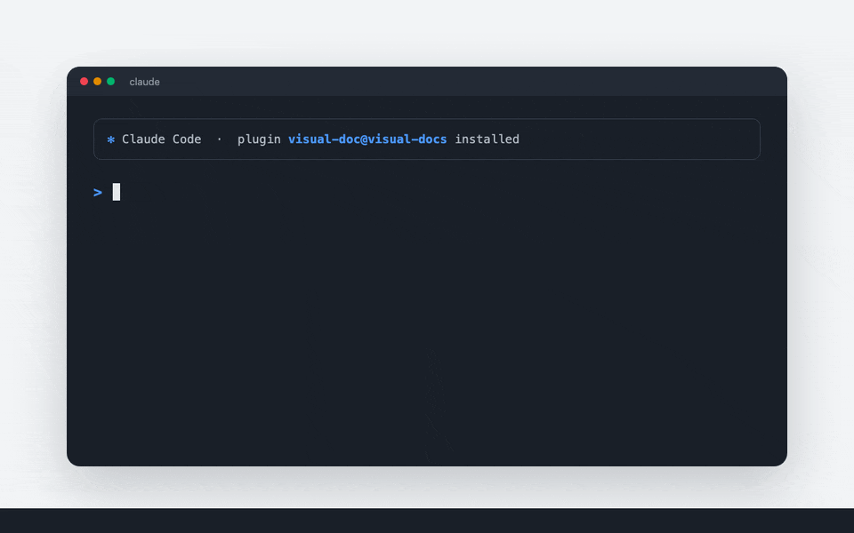
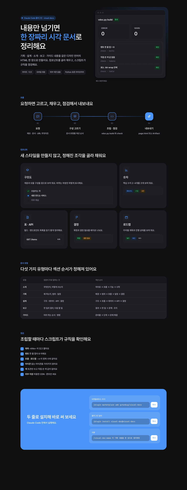

# visual-docs

A Claude Code plugin that turns plans, designs, reports and guides into a clean one-page visual document (HTML Artifact).



**[Live demo →](https://gutanbug.github.io/visual-docs/)**

- One design language: generous whitespace, gray hierarchy, a single blue accent, rounded surfaces
- Ready-made components: hero, flow, bento, stats, layers, tables, API list, decisions, roadmap
- Light / dark mode and mobile layout out of the box
- `vdoc.py` builds and lints the page using only the Python standard library
- Output text is written in Korean (해요체)

## Install

In Claude Code:

```
/plugin marketplace add gutanbug/visual-docs
/plugin install visual-doc@visual-docs
```

## Usage

```
/visual-doc:make Summarize docs/notify-design.md as a one-page design doc
```

Or just ask: "이 기획 내용을 아티팩트로 깔끔하게 정리해줘".
The page is written to `./visual-doc/<slug>/page.html` and published as an Artifact when the `Artifact` tool is available.

## Example

[`examples/visual-docs`](examples/visual-docs) was generated with this plugin.

<details>
<summary>Full page (dark)</summary>



</details>

## vdoc.py

```bash
python3 vdoc.py build --title "Notify design" --body body.html --out page.html [--css extra.css]
python3 vdoc.py check page.html
python3 vdoc.py serve page.html --port 8765
```

`check` catches missing titles, bento rows that don't sum to 6, flow/roadmap count mismatches, unknown icons, raw color values, disallowed external assets and unwrapped tables.

## License

[MIT](LICENSE)
